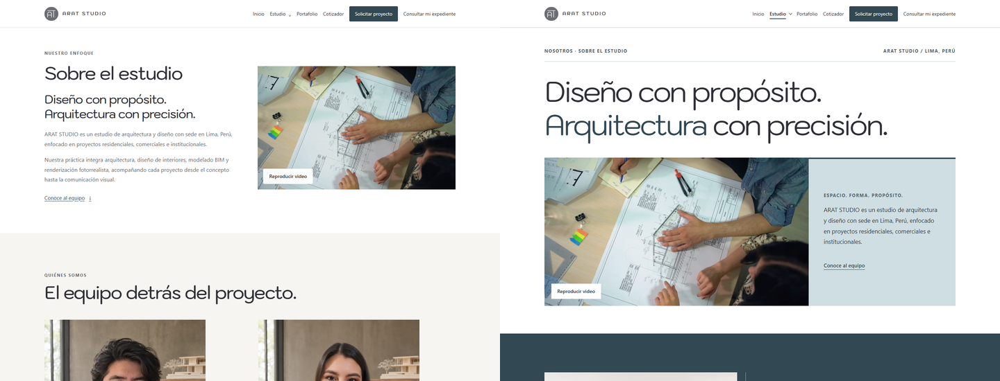
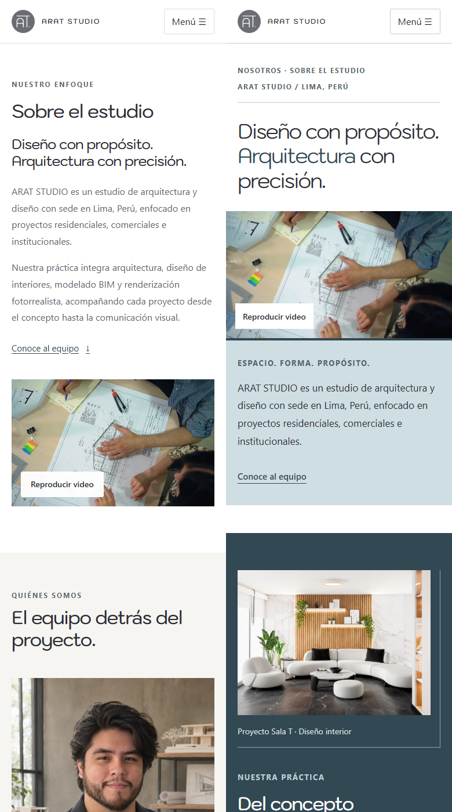

# ARAT STUDIO · rediseño editorial público

25 de noviembre de 2026 · America/Lima. Base de trabajo: `main`, `ac3a63a`.
Se conservaron los cambios posteriores y el archivo local no versionado encontrado.
No se hicieron commit, push ni despliegue.

[Abrir comparación interactiva de las ocho pantallas](index.html).

## Composición, color e interacción

Nosotros tiene una apertura propia: el mensaje principal ocupa la primera
jerarquía; el video arquitectónico se integra con un panel azul claro que presenta
el estudio. El bloque de práctica combina una imagen de Sala T y el contenido
existente en una retícula asimétrica sobre azul grisáceo. Esa imagen solo aparece
si el proyecto y su categoría continúan publicados.

Una transición clara introduce al equipo. Los retratos alternan posición en
escritorio, acompañados de nombre, cargo, formación y especialidades visibles.
En móvil se mantiene la secuencia retrato–información, sin invertir el orden de
lectura. No se cambiaron caras, nombres, credenciales ni archivos de retrato.
El cierre permite explorar proyectos o solicitar una evaluación.

Inicio combina una apertura en carbón con video de mayor presencia y un logo
menos dominante. Servicios tiene un índice de dos columnas con imágenes más
visibles. Portafolio muestra proyectos en dos columnas de escritorio y una de
móvil; su filtro conserva GET y actualización automática. Servicios y Portafolio
comparten cabeceras de color. El detalle comparte el cierre de Nosotros. El footer
organiza enlaces en dos columnas. Cotizador, solicitud y acceso mantienen su
composición funcional, con superficies, bordes y foco del sistema público.

El color procede de los logos y las referencias existentes: carbón `#2e2f36`,
azul grisáceo `#324853` y blanco. Se revisaron también los estilos del sitio
original, con negro, blanco y gris claro. Los tintes `#cedee2`, `#edf2f3` y
`#b9d1d9` derivan del azul y tienen funciones de capítulo, fondo y acento. Los
tonos madera presentes en los proyectos no se declararon colores de marca.
Las variables públicas no modifican los tokens del panel interno.
[Muestreo de logos y variables](palette.json).

Las entradas distinguen títulos, texto e imágenes y se aplican a elementos
seleccionados, mediante IntersectionObserver. Los botones y enlaces responden al
hover y foco; menús, acordeones y galería usan transiciones de opacidad y posición.
Los navegadores que no admiten transiciones discretas conservan apertura y cierre
nativos. El contenido es visible sin JavaScript y se desactiva el movimiento con
`prefers-reduced-motion`. Los videos mantienen silencio, poster, playsinline,
pausa accesible, carga diferida, detención fuera de pantalla y recuperación manual.

## Auditoría inicial y evidencia

Se abrieron las pantallas en Chrome y se guardaron 32 capturas iniciales antes de
editar las vistas. Las capturas finales repiten las ocho rutas a 360, 390, 768 y
1440 px. La galería permite elegir pantalla y ancho sin alterar los originales.

1. **Nosotros:** dos títulos competían en la apertura; el video compartía peso con
   el texto y el equipo repetía dos columnas idénticas. En móvil el video llegaba
   después de todo el texto introductorio. Se sustituyó esa composición y se
   separaron apertura, práctica y equipo.
2. **Inicio:** la retícula del fondo y el logo sobre el video dominaban la primera
   pantalla; servicios y equipo alargaban el mismo ritmo. Se dio prioridad al
   mensaje, el video y los resúmenes visuales.
3. **Servicios:** las imágenes eran pertinentes, pero el fondo y las divisiones
   apenas diferenciaban capítulos. Se reforzaron cabecera, bordes y pasos.
4. **Portafolio y detalle:** navegación, imágenes y filtro eran claros; tres
   columnas de escritorio reducían el tamaño de las láminas. Se amplió la retícula
   y se unificó el cierre del detalle con la presentación del estudio.
5. **Tareas:** ya eran legibles. Se conservaron campos, mensajes y orden de
   acciones; se reforzó el contraste de los bordes y la continuidad visual.

Las comparaciones anteriores recortan la misma altura inicial. Las capturas
completas están disponibles en la galería y en
[esta comparación de la página completa](comparacion-nosotros-completa.png).

## Código y recursos

Se reemplazaron las reglas anteriores de apertura y equipo, el fondo cuadriculado
de Inicio y la animación general `reveal-in`. Se retiró el modificador sin uso
`project-card--preview`. El componente de invitación se reutiliza en Nosotros y
detalle; `studio-intro`, equipo y videos mantienen componentes compartidos.
La navegación reconoce el grupo activo sin abrir automáticamente el desplegable.
Se mantuvo un solo listener por interacción y no se añadieron paquetes.

Se usaron únicamente logos, proyectos, fotografías y videos ya aprobados.
Los 112 archivos visuales coinciden por SHA-256 con el inventario conservado.
Las fuentes y licencias de los videos, los retratos proporcionados y los derivados
de proyectos permanecen en [la documentación de medios](../revision-3/README.md#fuentes-y-licencia).
Kodchasan y las licencias existentes de dependencias se conservaron.

Referencias consultadas y selección:

- [Input de vinodjangid07 en Uiverse](https://uiverse.io/vinodjangid07/good-donkey-28):
  se evaluó el tratamiento de foco; los campos se resolvieron con CSS local y
  bordes contrastados, sin copiar su componente.
- [Uiverse Galaxy](https://github.com/uiverse-io/galaxy) y su
  [licencia](https://github.com/uiverse-io/galaxy/blob/main/LICENSE): se revisaron
  como catálogo; no se incorporó código de sus autores.
- [Accordion de Bootstrap 5.3](https://getbootstrap.com/docs/5.3/components/accordion/):
  se mantuvieron las preguntas como `details` nativos para conservar uso sin JS.
  Los botones y campos siguen sobre Bootstrap existente.
- [Botones de Tabler](https://docs.tabler.io/ui/components/button): referencia
  de estados de controles, conservando Tabler en la administración.
- [Motion inView](https://motion.dev/docs/inview) y
  [su repositorio](https://github.com/motiondivision/motion): se evaluó el patrón
  de entrada por visibilidad. CSS e IntersectionObserver cubren esta necesidad;
  no se instaló Motion.

## Datos preservados

La verificación de solo lectura confirmó cuatro cuentas originales, quince
escenarios únicos del lote `arat-2026-v1`, una solicitud conservada por origen
dudoso, trece proyectos, 99 imágenes de galería, nueve cotizaciones y ocho PDFs
íntegros. No hay referencias huérfanas ni migraciones pendientes.

No aparecieron cuentas temporales ni solicitudes adicionales que justificaran
retiradas. **Registros eliminados: cero.** No se repitieron scripts de limpieza,
preparación del lote o migraciones. Los respaldos privados anteriores permanecen
intactos; no fue necesario restaurar ni borrar datos.

Los nombres de escenarios identifican su preparación inicial. La propuesta del
escenario `emitida`, por ejemplo, venció el 25 de noviembre a las 13:20 de Lima.
Se conservó su estado actual y sus fechas; no se renovó para rellenar pantallas.
Los escenarios de aceptación, rechazo, corrección y vencimiento siguen disponibles.
[Inventario actual de escenarios](data-inventory.json) y
[verificación de cuentas, catálogos, medios y PDFs](../final/data-editorial-20261125.json).

Respecto a la revalidación anterior, el inventario encontrado contiene un evento
de auditoría y un intento de aviso adicionales, cuatro sesiones y un registro de
bloqueo de caché. Se conservaron; no se clasificaron como basura ni se borraron.
Esta intervención no procesó avisos reales. Las pruebas de navegador usaron
SQLite, archivos separados y transporte de correo `array`.

## Validación y límites

- **119 pruebas, 1.261 aserciones**, sin errores, fallos ni omisiones. El nuevo
  caso verifica que Nosotros no muestre el proyecto si este o su categoría dejan
  de estar publicados. JUnit: `storage/framework/testing/editorial-20261125.xml`.
- Compilación Vite correcta; el CSS compilado del panel y el módulo de videos
  conservan sus hashes anteriores. 183 archivos PHP sin errores de sintaxis;
  Blade comprobado y vistas limpiadas.
- **32 capturas finales**, sin imágenes rotas ni desbordamientos horizontales en
  las ocho rutas y cuatro anchos. [Resultado](after/checks.json).
- **25 comprobaciones de medios y portafolio**, sin errores inesperados: pausa,
  reproducción, retirada de fuente, filtro, teclado, historial, destacados, orden,
  galería administrativa, movimiento reducido, ausencia de JS, autoplay bloqueado
  y video no disponible con reintento. [Resultado](media/checks.json).
- Teclado, salto al contenido, menú móvil, foco, acordeón, galería y Nosotros sin
  JS. Contraste calculado sobre colores renderizados: mínimo **4,52:1** en el
  conjunto de textos medidos y **3,87:1** en bordes de campos.
  [Mediciones y resultado](accessibility/checks.json).
- Recorrido hasta PDF, aceptación y cierre; corrección, vencimiento, versiones
  anteriores y rechazo conservado. Cliente sin acceso al panel interno; permisos
  de administrador y gestor cubiertos por la suite y recorrido administrativo
  existente. [Resultado y capturas](workflow/checks.json).
- Consola sin excepciones inesperadas y log del servidor sin errores PHP,
  advertencias ni excepciones de base de datos en la revisión.

No se afirma cumplimiento universal de accesibilidad. Las mediciones de color
no equivalen a una auditoría con lector de pantalla ni miden cada fotograma del
video. Se usó Chrome 158 local; no Safari, Firefox, dispositivos físicos ni SMTP
real. Los 640 px del recorrido representan reflujo, no zoom nativo al 200 %.
Las transiciones discretas tienen respaldo nativo en navegadores sin soporte.
No se probó producción ni se investigó la causa del apagado del equipo.

Los procesos temporales se cierran al finalizar; véase [registro de cierre](teardown.json).
El arranque de PHP 8.5, MariaDB y `composer dev` sigue en el [README](../../README.md).
[Resumen de comprobaciones en JSON](checks-summary.json).
