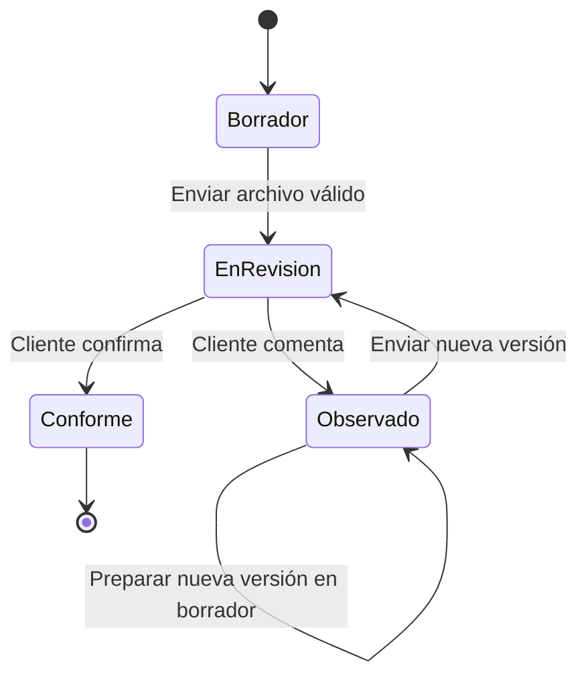
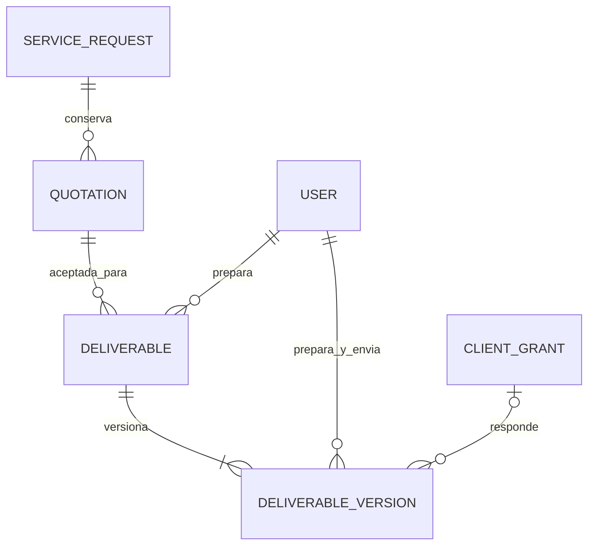

# Tercera presentación · entrega y revisión de documentos

25 de noviembre de 2026 · America/Lima. Implementación local sobre `7436dd5`,
conservando la rama `main` y el diseño aprobado. Sin commit, push ni despliegue.

[Galería de capturas reales](index.html) · [Cuatro bloques técnicos](BLOQUES-TECNICOS.md)
· [Métodos y líneas del corte final](source-map.json) · [Resultados](RESULTADOS.md).

## Proceso implementado

Una cotización aceptada mantiene el expediente comercial cerrado. A partir de esa
aceptación, el personal autorizado prepara un entregable, adjunta un documento y
lo envía a revisión. El cliente lo descarga con su acceso temporal y registra una
observación o su conformidad. Una observación permite preparar otra versión; cada
archivo enviado y cada respuesta se conservan. La conformidad finaliza ese
entregable y lo deja de solo lectura.

No se reabren solicitudes ni se modifican las cotizaciones aceptadas. La sección
documental continúa disponible para el cliente después del cierre; las acciones
comerciales de corregir, cancelar o cambiar correo siguen bloqueadas en ese estado.
No se incorporaron pagos, facturación, obras, roles nuevos ni firma certificada.



El estado del entregable es independiente de la publicación de sus versiones:
`sent_at` vacío identifica un borrador. Mientras se prepara v2, el entregable
permanece Observado y el cliente sigue viendo únicamente v1 enviada. El cliente
solo puede responder a la última versión enviada y aún sin respuesta.

## Acceso desde las pantallas

Personal interno: **Gestión comercial → expediente → Entregables**. Allí aparecen
título, estado, última versión y el enlace al siguiente paso. Con una aceptación
puede usar **Preparar entregable**; el detalle permite guardar el borrador, enviar,
consultar observaciones, preparar otra versión y descargar el historial.

Cliente: **Consultar mi expediente → acceso temporal verificado → Entregables**.
El encabezado del expediente enlaza directamente a la sección. Puede descargar
versiones enviadas, observar con comentario obligatorio o dar conformidad tras
marcar la confirmación y aceptar el diálogo. Los borradores y las notas internas
no se muestran. Sin JavaScript, la confirmación explícita y la validación del
servidor se conservan.

En local, el expediente interno conserva **Demostración local del acceso del
cliente**. El enlace de demostración se prepara desde ese formulario y se abre en
una ventana privada sin sesión interna. Es temporal y de un solo uso: no guardarlo
en documentación, capturas o enlaces públicos. El propio detalle del entregable
enlaza al formulario correspondiente, sin escribir una URL manualmente.

| Operación | Ruta |
| --- | --- |
| Abrir gestión | `/gestion` |
| Abrir expediente interno | `/gestion/solicitudes/{codigo}` |
| Formulario de entregable | `/gestion/solicitudes/{codigo}/entregables/crear` |
| Crear borrador | `POST /gestion/solicitudes/{codigo}/entregables` |
| Consultar detalle | `/gestion/entregables/{codigoENT}` |
| Guardar borrador o nueva versión | `POST /gestion/entregables/{codigoENT}/borrador` |
| Enviar versión | `POST /gestion/entregables/{codigoENT}/versiones/{numero}/enviar` |
| Descargar internamente | `/gestion/entregables/{codigoENT}/versiones/{numero}/archivo` |
| Consultar como cliente | `/mi-solicitud#entregables` |
| Responder | `POST /mi-solicitud/entregables/{codigoENT}/versiones/{numero}/responder` |
| Descargar como cliente | `/mi-solicitud/entregables/{codigoENT}/versiones/{numero}/archivo` |

Los valores visibles son títulos, nombres y códigos comerciales. El número de
versión es propio del entregable; no se presentan claves autoincrementales como
contenido de pantalla.

## Modelo, MVC y permisos



Se añadieron solo `deliverables` y `deliverable_versions`. El entregable referencia
una cotización; el expediente se obtiene de esa relación para evitar dos enlaces
que puedan contradecirse. Cada versión guarda título, descripción, nota interna,
metadatos del archivo, autor, publicación y una única respuesta con ClientGrant y
fecha. La respuesta pertenece a esa versión exacta, sin una tabla redundante.

Los modelos Eloquent contienen relaciones, casts y protección de contenido
enviado. Los controladores realizan operaciones concretas y redirigen a las vistas
Blade existentes. Los Form Requests validan campos y permisos iniciales. El
servicio `DeliverableWorkflowService` concentra las transacciones y repite la
autorización sobre filas actuales bloqueadas. Las vistas presentan los estados y
acciones; no conceden permisos ni deciden la validez de una operación.

| Actor | Ámbito y operaciones |
| --- | --- |
| Administrador activo | Ámbito de expedientes permitido por la Policy existente; consulta borradores y opera entregables válidos. |
| Gestor activo | Únicamente expedientes que siguen asignados a su cuenta. La lectura del responsable se hace de nuevo; una reasignación invalida el permiso anterior. |
| Cliente | ClientGrant vigente, no revocado y correspondiente al expediente y correo actuales. Solo versiones enviadas. |
| Sesión interna en rutas de cliente | Rechazada, incluso si conserva un acceso temporal en la sesión. |
| Cuenta desactivada / acceso vencido | Sin consulta privada ni operaciones autorizadas. |

Se reutilizan `ServiceRequestPolicy`, `ClientAccessService` y `EnsureClientGrant`.
No se añadió una forma de suplantar al cliente ni una reasignación que reabra el
expediente cerrado. Los permisos de lectura y operación siguen al responsable
vigente del expediente.

## Archivos, versiones y transacciones

Se aceptan PDF, PNG y JPEG de hasta 10 MiB. Se comprueban tamaño, MIME, extensión
y contenido: imágenes reconocibles y PDF con cabecera y cierre de documento.
No es un antivirus ni una evaluación semántica de un plano. La validación de
autenticidad de un servicio profesional queda fuera de este flujo académico.

Los archivos se guardan en el disco privado `commercial`, bajo `deliverables/`,
con nombres UUID y extensión canónica. El nombre original se conserva como
información y nombre de descarga. Ninguna ruta pública de almacenamiento los
expone; el controlador verifica permiso e integridad SHA-256 y entrega una
descarga con MIME controlado, `nosniff` y `private, no-store`.

Un archivo nuevo sin referencia se limpia si falla la transacción. Solo se retira
el archivo sustituido de un borrador después del commit; nunca uno que conserve
una versión. Si no puede determinarse si una escritura quedó confirmada, la
limpieza comprueba las referencias antes de borrar.

La creación y el guardado utilizan claves de operación y huellas de contenido.
Una repetición idéntica devuelve el registro existente. Se combinan bloqueos de
filas, un contador de edición y el índice único `(deliverable_id, number)`. Las
consultas de repetición y última versión son lecturas bloqueantes para no operar
sobre una instantánea antigua de MariaDB. Una decisión opuesta o una respuesta a
una versión sustituida devuelve 409; no sobrescribe el historial.

La auditoría existente registra creación, guardado, envío y respuesta, con actor,
código y versión. No se registran tokens, credenciales ni enlaces de acceso.
Los avisos por correo no son requisito para publicar o consultar un entregable.

## Migración, respaldo y conservación

Se probó la migración en SQLite y MariaDB aislados antes de aplicarla. Después se
respaldaron 28 tablas y 239 archivos, incluyendo configuración y documentos
privados, y se restauraron en una base distinta para comparar datos y hashes.

- Migración aplicada: `2026_11_25_220000_create_deliverables`.
- Respaldo privado: `storage/app/private/third-presentation/20261126_041048/`.
- SQL: `database.sql`; archivos: `files.zip`; verificación: `receipt.json`.
- Restauración comprobada: `arat_delivery_restore_20261126_041053`.

Los nombres del respaldo usan UTC; la intervención corresponde al 25 de noviembre
en Lima. No se restauró sobre `arat_studios`. No se alteraron `.env`, APP_KEY,
contraseñas, IDs ni roles de las cuatro cuentas existentes. Se verificaron 532
filas previas y 239 archivos sin cambios; se mantuvieron las 16 solicitudes,
quince del lote Faker y una de origen dudoso, los 13 proyectos y 99 imágenes.
No quedaron referencias huérfanas. [Verificación de datos](data-verification.json).

## Demostración preparada en la instalación habitual

Los tres entregables usan la cotización aceptada del lote Faker
`COT-01M88C7CKP38VV8QJEDJA8C3NF`, del expediente
`SOL-01M88C7CH75DR20MWSWAVTFV46`. No se necesitó crear ni alterar otra solicitud.

| Título académico | Estado preparado | Versiones |
| --- | --- | --- |
| Propuesta de distribución | En revisión | v1 enviada, pendiente de respuesta |
| Planos arquitectónicos | En revisión | v1 observada y v2 enviada |
| Informe de diseño | Conforme | v1 conforme, fecha e historial conservados |

Hay cuatro PDFs privados válidos, marcados **DEMOSTRACIÓN ACADÉMICA**. La
repetición del comando dejó iguales entregables, versiones, auditoría y archivos.
No se enviaron correos reales ni se regeneró el lote Faker.

```powershell
. .\tools\use-php.ps1
php artisan demo:deliverables
```

El comando anterior muestra el plan. Para una preparación explícita en local,
con la aplicación en mantenimiento y sin cola/scheduler ejecutándose:

```powershell
php artisan down
php artisan demo:deliverables --apply
php artisan up
```

No hace falta repetirlo para exponer. El administrador activo se selecciona por
defecto; `--actor=...` permite indicar una cuenta autorizada existente. Si no hay
una aceptación del lote en su ámbito, el comando informa el problema y conserva
los datos. No altera cotizaciones ajenas ni reinicia escenarios que el usuario
ya haya revisado. Un entregable conforme no se reinicia.

Para practicar sin cambiar esos tres casos, crear otro entregable académico sobre
la misma aceptación. La base de las capturas y pruebas es una SQLite separada;
sus gestores y expedientes son ficticios, sin copiar contraseñas reales.

## Arranque y parada

El servidor de `127.0.0.1:8000` y MariaDB ya estaban activos al empezar y se
conservan. Si se necesita arrancar desde cero, preparar cada terminal con el helper
y seguir el [README principal](../../README.md#arrancar-y-detener):

```powershell
. .\tools\use-php.ps1
.\tools\start-database.ps1
```

En otra terminal preparada:

```powershell
composer dev
```

No iniciar otro servidor si ya hay uno en 8000. Detener `composer dev` con Ctrl+C;
detener con Ctrl+C la terminal de MariaDB iniciada para esa sesión. El servidor
aislado en 8765 de esta revisión se detiene al finalizar. No se detienen procesos
del usuario ni se cambia el arranque del sistema.

## Librerías y requisitos de la exposición

Laravel 13 aporta rutas, middleware, Form Requests, Policies, Eloquent y
transacciones. Blade construye las pantallas del servidor; Bootstrap y Tabler
mantienen los controles públicos e internos. Kodchasan y los colores aprobados se
conservan. El disco privado y SHA-256 protegen la entrega e integridad; DomPDF,
ya instalado, genera los ejemplos académicos. PHPUnit y Playwright comprueban
reglas e interacción; Sharp solo preparó un JPEG pequeño de ensayo para las
pruebas, sin cambiar medios de la web. No se añadieron dependencias.

Los cuatro CRUD existentes —proyectos, categorías, servicios y tarifas— conservan
sus rutas, datos y controles. Se recorrieron sus listados en navegador y se
ejecutaron las regresiones existentes de catálogos. El proceso comercial previo
también conserva su suite y sus diez comprobaciones de concurrencia en MariaDB.

El reparto para Rolando Sanchez, Christian Roque, Alejandro Nolasco y Guyin
Palacios incluye interfaz, código y validaciones de dificultad comparable en
[BLOQUES-TECNICOS.md](BLOQUES-TECNICOS.md).
